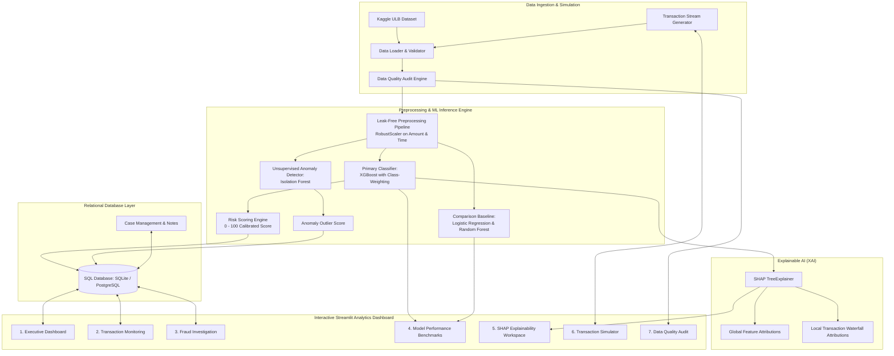

# 🛡️ Real-Time Financial Fraud Detection & Investigation Platform

[](https://www.python.org/)
[](https://xgboost.readthedocs.io/)
[](https://shap.readthedocs.io/)
[](https://streamlit.io/)
[](https://www.sqlalchemy.org/)
[](https://pytest.org/)

An enterprise-grade, end-to-end Machine Learning, Explainable AI (SHAP), SQL Persistence, and Streamlit Analytics application for real-time financial fraud surveillance, anomaly detection, and fraud analyst case investigation.

Designed for:
- 🎓 **Final-Year Academic & Capstone Projects**
- 💼 **Senior Data Scientist / ML Engineer Portfolios**
- 🎯 **Technical Machine Learning Interviews**
- 🌐 **Open-Source GitHub Publication**

---

## 📌 Executive Summary & Problem Statement

Financial institutions process millions of transactions daily. Fraudulent activities account for billions of dollars in losses annually. However, financial fraud datasets are characterized by **extreme class imbalance** (e.g., $< 0.2\%$ of transactions are fraudulent). A naive model predicting all transactions as legitimate would achieve $> 99.8\%$ accuracy while failing completely at stopping fraud.

This platform resolves this challenge by combining:
1. **Cost-Sensitive Supervised Classification (XGBoost, Random Forest, Logistic Regression)** optimized for **PR-AUC (Average Precision)** and **Recall**.
2. **Unsupervised Outlier Detection (Isolation Forest)** to screen novel structural anomalies independent of labels.
3. **Game-Theoretic Explainability (SHAP)** decomposing model predictions into feature-level positive and negative risk attributions.
4. **Calibrated Risk Scoring Engine (0 to 100)** mapping posterior probabilities to actionable operational risk categories.
5. **Human-in-the-Loop Case Management & SQL Persistence** allowing investigators to examine alerts, record case notes, and resolve cases.
6. **Real-Time Streaming Transaction Simulator** demonstrating live payment ingestion, automated scoring, and alert generation.

---

## 🏗️ System Architecture



---

## 🗂️ Project Directory Structure

```text
financial-fraud-detection/
├── app.py                            # Streamlit landing page & quick risk analyzer
├── requirements.txt                  # Production dependencies
├── README.md                         # Portfolio documentation
├── .gitignore                        # Git exclusion rules
├── .env.example                      # Environment template
│
├── config/
│   ├── __init__.py
│   └── settings.py                   # Centralized configuration & thresholds
│
├── data/
│   ├── raw/                          # Raw Kaggle creditcard.csv location
│   ├── processed/                    # Processed / transformed sets
│   ├── reports/                      # Quality & model evaluation reports
│   └── fraud_detection.db            # SQLite operational database
│
├── notebooks/
│   └── 01_fraud_detection_eda.ipynb  # Comprehensive EDA Jupyter Notebook
│
├── src/
│   ├── data/
│   │   ├── load_data.py              # Robust loader with demo fallback
│   │   ├── validate_data.py          # Schema & data quality audit
│   │   └── preprocess.py             # Chronological split & RobustScaler
│   ├── features/
│   │   └── feature_engineering.py    # Temporal & transaction magnitude features
│   ├── models/
│   │   ├── train.py                  # Multi-model training pipeline
│   │   ├── evaluate.py               # PR-AUC, ROC, confusion matrix & cost simulator
│   │   ├── predict.py                # Real-time inference engine
│   │   ├── anomaly_detection.py      # Isolation Forest unsupervised detector
│   │   └── risk_scoring.py           # 0-100 score mapping & risk tiers
│   ├── explainability/
│   │   └── shap_explainer.py         # SHAP TreeExplainer & narrative generator
│   ├── database/
│   │   ├── connection.py             # SQLAlchemy session & SQLite/PostgreSQL engine
│   │   ├── models.py                 # Transactions, Predictions, Investigations ORM
│   │   └── crud.py                   # Safe parameterized database operations
│   ├── simulation/
│   │   └── transaction_stream.py     # Live transaction streaming engine
│   └── utils/
│       ├── logging_config.py         # Structured logging configuration
│       ├── helpers.py                # Transaction IDs, serialization, synthetic samples
│       └── ui_components.py          # Custom CSS theme, badges, metric cards, Plotly
│
├── pages/
│   ├── 1_Dashboard.py                # Executive metrics, charts & alert feed
│   ├── 2_Transaction_Monitoring.py   # Searchable grid, risk filters & CSV export
│   ├── 3_Fraud_Investigation.py      # Case forensics, SHAP attributions & notes
│   ├── 4_Model_Performance.py        # Benchmark comparison, curves & cost simulator
│   ├── 5_SHAP_Explainability.py       # Global & individual feature explainability
│   ├── 6_Transaction_Simulator.py    # Streaming controls, live scoring & visualizer
│   └── 7_Data_Quality.py             # Schema audit, imbalance stats & certificate
│
├── artifacts/
│   ├── models/                       # Persisted pipelines, best model, metadata
│   └── explainers/                   # Saved explainer configurations
│
├── tests/
│   ├── test_data_validation.py       # Schema & missingness test cases
│   ├── test_preprocessing.py         # Chronological order & leakage tests
│   ├── test_prediction.py            # Predictor output shapes & probability bounds
│   ├── test_risk_scoring.py          # Boundary tests & category classifications
│   └── test_database.py              # In-memory SQLite CRUD & case update tests
│
└── docs/
    ├── project_architecture.md       # Comprehensive system architecture & diagrams
    └── model_card.md                 # Model Card following Mitchell et al. standards
```

---

## 📊 Dataset Setup

This project uses the benchmark **ULB Machine Learning Group Credit Card Fraud Detection** dataset:
- **Download link:** [Kaggle Credit Card Fraud Detection](https://www.kaggle.com/datasets/mlg-ulb/creditcardfraud)
- Place the downloaded file into:
  ```text
  data/raw/creditcard.csv
  ```

> **Demo Fallback Mode:** If `creditcard.csv` is not present, the system automatically falls back to an integrated synthetic generator that mirrors the exact 30-feature schema (`Time`, `Amount`, `V1-V28`, `Class`). Every synthetic record is explicitly labeled so models are never fraudulently represented as real banking records.

---

## 🚀 Quickstart & Installation

### 1. Clone & Set Up Environment

#### Windows (PowerShell):
```powershell
# Clone the repository
git clone https://github.com/your-username/real-time-fraud-detection.git
cd "real-time-fraud-detection"

# Create virtual environment (optional)
py -m venv .venv
.venv\Scripts\activate

# Install dependencies
py -m pip install -r requirements.txt
```

#### Linux / macOS:
```bash
python3 -m venv .venv
source .venv/bin/activate
pip install -r requirements.txt
```

---

### 2. Train Models & Persist Artifacts

Run the automated training and model comparison pipeline:
```bash
# Windows
py -m src.models.train

# Linux/macOS
python3 -m src.models.train
```
This script:
1. Loads dataset (or demo fallback)
2. Executes leak-free chronological splitting (70% Train, 10% Val, 20% Test)
3. Fits RobustScaler for `Amount` and `Time`
4. Calculates cost-sensitive class weights (`scale_pos_weight`)
5. Trains **Logistic Regression**, **Random Forest**, **XGBoost**, and **Isolation Forest**
6. Benchmarks all candidates on held-out test data
7. Saves the best model (`best_model.joblib`), preprocessor (`preprocessor.joblib`), and audit metadata to `artifacts/models/`.

---

### 3. Run Automated Tests

Execute the full Pytest test suite:
```bash
# Windows
py -m pytest -v

# Linux/macOS
pytest -v
```

**Results:**
```text
tests/test_data_validation.py::test_synthetic_data_schema PASSED         [  7%]
tests/test_data_validation.py::test_missing_and_duplicate_detection PASSED [ 14%]
tests/test_data_validation.py::test_load_dataset_fallback PASSED         [ 21%]
tests/test_database.py::test_insert_and_retrieve_transaction PASSED      [ 28%]
tests/test_database.py::test_update_investigation_case PASSED            [ 35%]
tests/test_database.py::test_dashboard_metrics_aggregation PASSED        [ 42%]
tests/test_prediction.py::test_predictor_loaded_and_predicts PASSED      [ 50%]
tests/test_prediction.py::test_batch_prediction_shape PASSED             [ 57%]
tests/test_preprocessing.py::test_chronological_split PASSED             [ 64%]
tests/test_preprocessing.py::test_preprocessor_fit_transform PASSED      [ 71%]
tests/test_preprocessing.py::test_missing_feature_raises_error PASSED    [ 78%]
tests/test_risk_scoring.py::test_risk_score_bounds PASSED                [ 85%]
tests/test_risk_scoring.py::test_risk_category_assignment PASSED         [ 92%]
tests/test_risk_scoring.py::test_score_transaction_payload PASSED        [100%]

====================== 14 passed in 1.87s ======================
```

---

### 4. Launch Streamlit Application

Launch the interactive UI:
```bash
# Windows
py -m streamlit run app.py

# Linux/macOS
streamlit run app.py
```
Open your browser at `http://localhost:8501`.

---

## 🖥️ Streamlit Application Walkthrough

| Page | Key Capabilities |
| :--- | :--- |
| **Landing (`app.py`)** | System readiness indicators, real-time KPI overview, interactive quick single-transaction risk analyzer. |
| **1. Executive Dashboard** | Macro-level transaction surveillance, volume trends, risk tier distributions, fraud probability shifts, high-priority suspicious alerts. |
| **2. Transaction Monitoring** | Real-time transaction surveillance grid with reference search, risk tier filters, minimum score sliders, and instant CSV export. |
| **3. Fraud Investigation** | Individual forensic case viewer, SHAP risk-increasing vs mitigating driver bar charts, investigator notes, and case resolution persistence. |
| **4. Model Performance** | Benchmark comparison of XGBoost, Random Forest, & Logistic Regression. Interactive PR & ROC curves, confusion matrices, and configurable Business Cost Simulator. |
| **5. SHAP Explainability** | Global feature importance rankings, summary distribution, and local transaction waterfall attributions with human-readable narratives. |
| **6. Transaction Simulator** | Live streaming payment simulator with Play/Pause/Reset controls, batch size and interval settings, live scatter charts, and instant database ingestion. |
| **7. Data Quality Audit** | Schema inspection, null and duplicate counts, extreme class imbalance breakdown, and downloadable JSON Data Quality Report. |

---

## 🎯 Risk Scoring Methodology

The risk score is a transparent, calibrated mapping of posterior fraud probability $P(\text{Fraud} \mid X) \in [0, 1]$ scaled to a discrete $0 - 100$ scale:

$$\text{Risk Score} = \text{round}(P(\text{Fraud} \mid X) \times 100, 2)$$

| Risk Tier | Score Range | Operational Action |
| :--- | :--- | :--- |
| **Low Risk** | `0.0` - `24.9` | Automated approval; standard settlement. |
| **Medium Risk** | `25.0` - `59.9` | Elevated scrutiny; step-up verification / 3D-Secure recommended. |
| **High Risk** | `60.0` - `84.9` | High priority investigator queue; temporary authorization hold. |
| **Critical Risk** | `85.0` - `100.0` | Immediate transaction block; proactive cardholder contact. |

> **Mathematical Integrity Notice:** Isolation Forest anomaly scores are presented as independent outlier signals and are **not** arbitrarily added to supervised probabilities without calibration.

---

## ⚖️ Ethical Considerations & Investigation Disclaimer

- **Decision Support Only:** This application is intended strictly for financial crime investigation support and does not replace human fraud investigators.
- **Explainability Limitations:** SHAP explains statistical model correlation within the training feature distribution; it does not constitute legal proof of malicious intent.
- **Privacy Assurance:** The application processes anonymized PCA features and does not store or transmit raw Primary Account Numbers (PAN), CVVs, or cardholder credentials.

---

## 📜 License & Acknowledgments

- **Dataset:** [ULB Machine Learning Group](https://www.kaggle.com/datasets/mlg-ulb/creditcardfraud)
- **License:** Open Source MIT License
