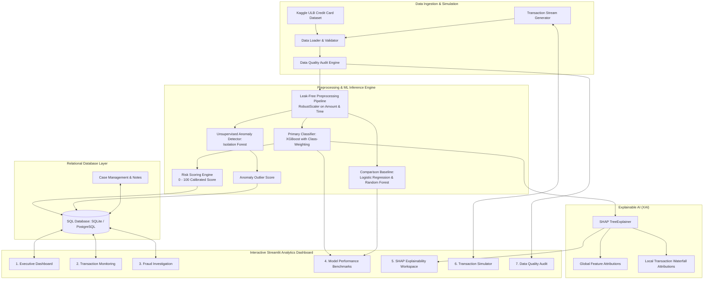

# System Architecture & Technical Specifications

## 1. High-Level Architecture Overview

The **Real-Time Financial Fraud Detection & Investigation** platform is an enterprise-grade financial risk intelligence system designed to process transaction streams, evaluate supervised and unsupervised machine learning models, generate game-theoretic SHAP explanations, and manage investigation workflows.

---

## 2. Core Architectural Components

### 2.1 Ingestion & Validation Layer (`src/data/`)
- **`load_data.py`**: Resolves `data/raw/creditcard.csv`. If absent, gracefully transitions into synthetic demo mode with full schema parity.
- **`validate_data.py`**: Audits incoming payloads for expected columns (`Time`, `Amount`, `V1-V28`, `Class`), checks null counts, detects duplicate records, and computes imbalance metrics.
- **`preprocess.py`**: Enforces strict chronological train/val/test splitting (`0.70 / 0.10 / 0.20`) based on `Time`. Employs `RobustScaler` on `Amount` and `Time` using median and IQR to mitigate outlier sensitivity while preserving pre-whitened PCA features (`V1-V28`).

### 2.2 Machine Learning Inference & Risk Engine (`src/models/`)
- **`XGBoost Classifier`**: Primary supervised model optimized for extreme minority-class recall and precision using `scale_pos_weight` and PR-AUC loss.
- **`Isolation Forest`**: Outlier detector evaluating multi-dimensional deviations independently from supervised labels.
- **`RiskScorer` (`src/models/risk_scoring.py`)**: Converts raw posterior probability into a normalized `0 - 100` score mapped to operational tiers:
  - **Low Risk (0.0 - 25.0)**: Standard automated approval.
  - **Medium Risk (25.0 - 60.0)**: Step-up authentication / elevated scrutiny.
  - **High Risk (60.0 - 85.0)**: Priority fraud review queue.
  - **Critical Risk (85.0 - 100.0)**: Immediate transaction hold / card freeze.

### 2.3 Explainability Layer (`src/explainability/`)
- Utilizes `shap.TreeExplainer` on fitted tree structures.
- Evaluates individual Shapley attributions, isolating **top risk-elevating factors** (+SHAP) from **mitigating factors** (-SHAP).
- Formulates automated, human-readable forensic summary narratives for investigators.

### 2.4 SQL Persistence Layer (`src/database/`)
- Implemented via **SQLAlchemy ORM** targeting `sqlite:///data/fraud_detection.db` with direct zero-code portability to PostgreSQL via `DATABASE_URL`.
- Tables:
  1. `transactions`: Raw transaction payload, monetary amount, timestamp offset, serialized features.
  2. `predictions`: Fraud probabilities, risk scores, risk tiers, binary decisions, anomaly scores.
  3. `investigations`: Investigation state (`New`, `Under Review`, `Confirmed Fraud`, `Legitimate`, `Escalated`), analyst notes, resolution outcomes.

---

## 3. Security, Performance & Scalability

1. **Parameterization**: All database queries are fully parameterized via SQLAlchemy to eliminate SQL injection vulnerabilities.
2. **Caching Strategy**: SHAP global background evaluations and large metric queries are memoized using `@st.cache_data`.
3. **Temporal Integrity**: Transformations are fitted exclusively on the training partition to eliminate lookahead data leakage.
4. **Privacy & Compliance**: Zero PII (Personally Identifiable Information) or plain-text card credentials (PAN/CVV) are stored or processed.
